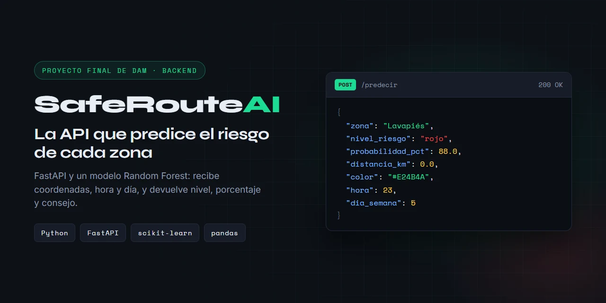
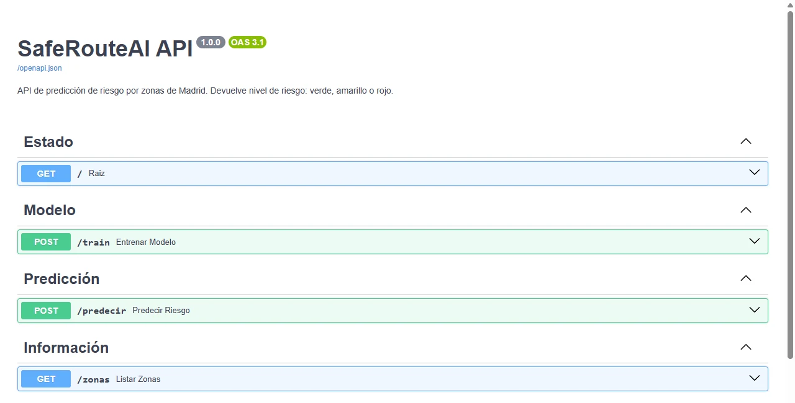
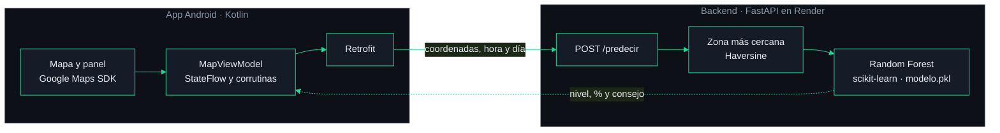

<div align="center">



<br>

**API en Python que predice el nivel de riesgo de una zona de Madrid según la hora y el día. La consume la app Android de SafeRouteAI.**

<br>

[](https://saferoute-ai-backend-kt6q.onrender.com/docs)
[](https://github.com/cristian-corroto/saferoute-ai-android)


</div>

---

## En 30 segundos

Backend de **SafeRouteAI**, mi proyecto final del ciclo de Desarrollo de Aplicaciones Multiplataforma (DAM, junio de 2026).

- 📍 Recibe unas **coordenadas GPS, una hora y un día** de la semana.
- 🧭 Busca la **zona conocida más cercana** con la fórmula de Haversine.
- 🌲 Un modelo **Random Forest** (scikit-learn, 200 árboles) devuelve el nivel de riesgo, un porcentaje y un consejo.
- ☁️ Está **publicado en Render**, con documentación interactiva generada por FastAPI.

> **Sobre los datos:** el modelo se entrena con 10.000 registros **simulados** que genera `generar_datos.py` a partir de 6 zonas y reglas escritas por mí (hora, día, densidad y distancia). **No son datos delictivos reales** y las predicciones no deben usarse para decisiones de seguridad. Es un proyecto de aprendizaje.

---

## Pruébala

Petición real a la API publicada:

```bash
curl -X POST https://saferoute-ai-backend-kt6q.onrender.com/predecir \
  -H "Content-Type: application/json" \
  -d '{"latitud": 40.4088, "longitud": -3.7013, "hora": 23, "dia_semana": 5, "densidad": 70}'
```

```json
{
  "zona": "Lavapiés",
  "distancia_km": 0.0,
  "nivel_riesgo": "rojo",
  "probabilidad_pct": 88.0,
  "color": "#E24B4A",
  "consejo": "Zona de alto riesgo. Evita esta área, especialmente de noche.",
  "hora": 23,
  "dia_semana": 5
}
```

<sub>Está en un servidor gratuito: la primera petición puede tardar cerca de un minuto mientras el servicio despierta.</sub>

<a href="https://saferoute-ai-backend-kt6q.onrender.com/docs"></a>
<p align="center"><sub><b>Documentación interactiva</b> · generada por FastAPI, se puede probar cada endpoint desde el navegador.</sub></p>

---

## Cómo funciona



| Método | Ruta | Qué hace |
|---|---|---|
| GET | `/` | Estado de la API y del modelo |
| POST | `/train` | Entrena el modelo con el CSV y lo guarda en `modelo.pkl` |
| POST | `/predecir` | Predice el riesgo para unas coordenadas, hora y día |
| GET | `/zonas` | Lista las zonas con sus coordenadas |

**Zonas cubiertas:** Lavapiés, Carabanchel, Vallecas, Sol/Gran Vía, AZCA y Becerril de la Sierra. Cualquier punto se asigna a la más cercana. Para Becerril, una regla fija devuelve siempre verde.

| Archivo | Función |
|---|---|
| `api.py` | API FastAPI: endpoints, validación con Pydantic y predicción |
| `generar_datos.py` | Genera los 10.000 registros simulados |
| `datos_riesgo_madrid.csv` | Datos de entrenamiento |
| `modelo.pkl` | Modelo entrenado |
| `test_api.py` | Prueba la API desde la terminal |

## Cómo ejecutarla

```bash
python -m venv .venv
.venv\Scripts\activate          # en Linux/macOS: source .venv/bin/activate
pip install -r requirements.txt
uvicorn api:app --reload
```

La documentación interactiva queda en <http://127.0.0.1:8000/docs>. Si `modelo.pkl` no existe, llama una vez a `POST /train`. Para regenerar los datos: `python generar_datos.py`. Con la API en marcha, `python test_api.py` la prueba desde la terminal (necesita `pip install requests`).

## Limitaciones

- Datos simulados y solo 6 zonas.
- El modelo aprende las reglas con las que se generaron los datos, no patrones reales.
- La demo está en un servidor gratuito: la primera respuesta puede tardar al despertar el servicio.

## Autor

Desarrollado por **Cristian Corroto** como parte de su proyecto final de DAM, con apoyo intensivo de IA, sobre todo en esta parte en Python, que no formaba parte del ciclo. Yo definí qué debía predecir, escribí las reglas de los datos simulados y probé la API con la app.

[App Android](https://github.com/cristian-corroto/saferoute-ai-android) · [Descargar el APK](https://saferouteai-app.netlify.app/) · [Portfolio](https://cristian-corroto.netlify.app) · [LinkedIn](https://www.linkedin.com/in/cristian-corroto)
